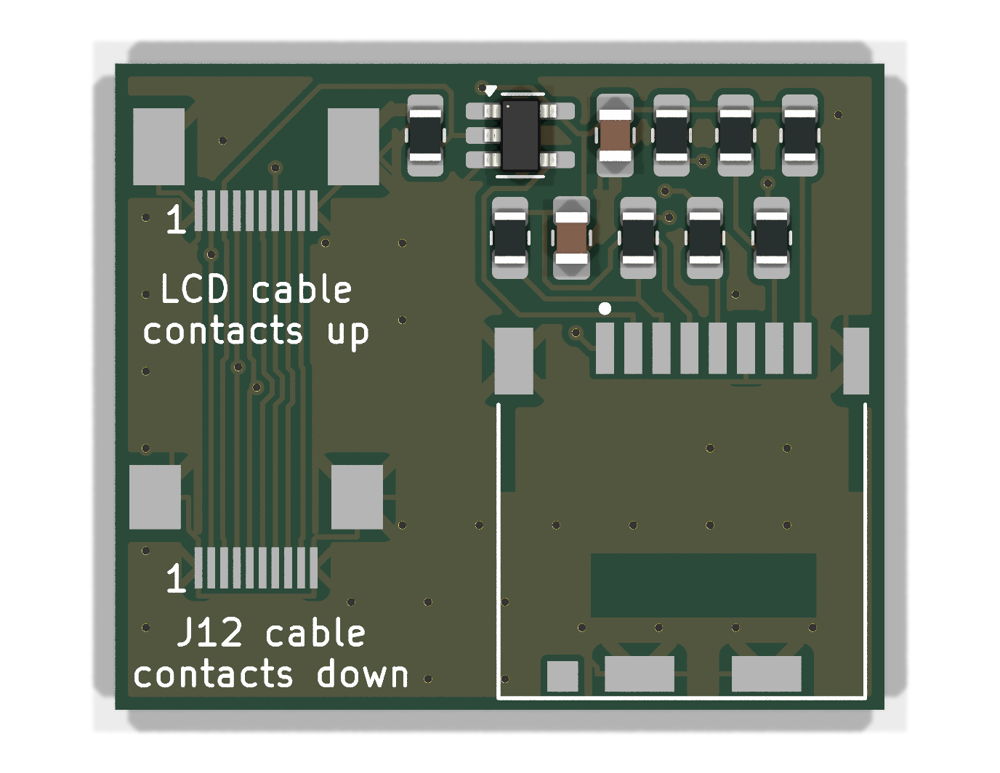
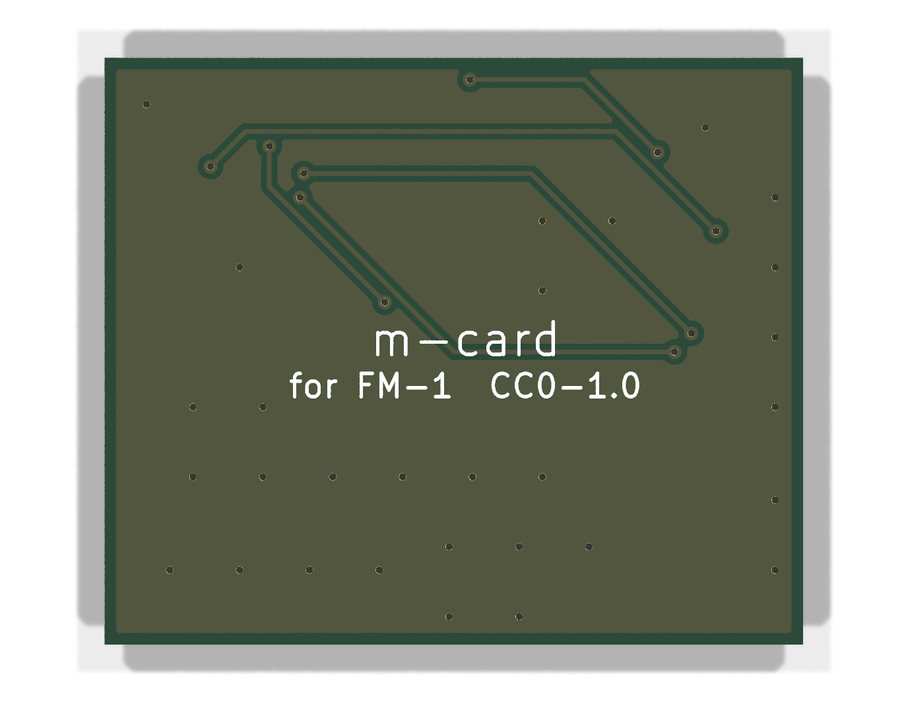

# m-card

A small add-on board (30 × 25.2 mm) that gives the **M-VAVE FM-1** a microSD card slot. **No soldering to the FM-1 is
needed.** The board sits under the audio jacks and plugs in between the FM-1's LCD and its main board, so the card
shares the LCD's SPI bus.

| Top | Bottom |
|---|---|
|  |  |

> **Status: untested prototype.** The board's fit has been checked with a paper template on a real FM-1, but no board
> has been made or tested yet. Order a small batch, and expect changes. The card also needs FM-1 firmware that knows
> about it: that support is being worked on in [m-bootloader](https://github.com/jvitkauskas/m-bootloader).

## I just want to order a board

Everything you need is already in this repository. You don't have to install KiCad or run anything.

### 1. Order the PCB

Upload [`fab/m-card-gerbers.zip`](fab/m-card-gerbers.zip) to [JLCPCB](https://jlcpcb.com) or any other PCB maker that
takes Gerbers. The size (30 × 25.2 mm) is read from the files, and the design rules are standard (0.2 mm tracks and
spacing, 0.3 mm holes), so the default settings work. A few are worth a look:

| Setting | Choice | Notes |
|---|---|---|
| Layers | 2 | |
| PCB thickness | 1.0 mm recommended; 1.6 mm is fine | Thinner leaves more room under the FM-1's cover. Don't pay extra for it. |
| Surface finish | HASL (lead-free or with lead) | The cheap default, and the easiest to hand-solder. ENIG has flatter pads, but it's optional and often costs several times more. OSP is fine if you'll solder the boards soon, since it doesn't keep well. |
| Mark on PCB | "Remove mark" if it's free | Otherwise JLC prints its order number somewhere on the board. |

### 2. Buy the parts

All parts are in stock at [LCSC](https://www.lcsc.com). Search for the part numbers below. A few spares of the
small resistors and capacitors are handy.

| Qty | Refs | Part | LCSC |
|---|---|---|---|
| 1 | J1 | Hirose DM3CS-SF, hinged microSD socket | C202111 |
| 1 | J2 | XUNPU FPC-05F-10PH20, 10-pin 0.5 mm FPC socket, **bottom** contact | C2856798 |
| 1 | J3 | XUNPU FPC-0.5AS-10PWBH20, 10-pin 0.5 mm FPC socket, **top** contact | C3446068 |
| 1 | U1 | 74LVC1G04 inverter, SOT-23-5 (TI SN74LVC1G04DBVR) | C7827 |
| 5 | R2, R3, R4, R7, R8 | 47 kΩ, 0805 | C17713 |
| 2 | R5, R6 | 470 Ω, 0805 | C17710 |
| 1 | R1 | 220 Ω, 0805 | C17557 |
| 1 | C1 | 10 µF, 0805 | C15850 |
| 1 | C2 | 100 nF, 0805 | C49678 |
| 1 | | 10-pin, 0.5 mm pitch FFC cable, about 80 mm, contacts on the same side at both ends ("type A") | |
| | | Thin double-sided tape | |

You also need a microSD card.

The FFC cable runs from the FM-1's J12 to the board's J2. The cable type and length are what the first build is
planned with: please report back if they don't work.

### 3. Solder it

Print [`docs/assembly.pdf`](docs/assembly.pdf). It shows every part's position and value at 5:1, which way round
the parts go, and a good order to solder them in.

- Every part is hand-solderable with a fine-tip iron. The 0805 and SOT-23-5 parts use extra-long pads.
- The two FPC sockets (J2, J3) are the fiddly part, at 0.5 mm pitch. Use plenty of flux, tack one tab, drag-solder the
  row, and wick off any bridges.
- **Before you install it:** check with a multimeter that 3.3 V (J2 line 7) is not shorted to GND (line 1), and that
  each J2 line beeps through to the same J3 line.

### 4. Install it

[`docs/template-1to1.pdf`](docs/template-1to1.pdf) is a 1:1 paper template. Print it at 100 % ("actual size"), check
its 50 mm scale bars with a ruler, cut out the board outline, and lay it in the FM-1 to see where the board goes.

1. Open the FM-1 and disconnect the battery.
2. Unplug the LCD's cable from J12 on the FM-1's main board, and plug it into the board's **J3** (contacts up).
3. Connect the FM-1's J12 to the board's **J2** with the short FFC cable (contacts down at J2).
4. Tape the board down under the audio jacks, with J3 right below the gap between the two jacks.

The silkscreen next to each socket repeats which way the cable's contacts face, and marks the cable's line 1.

### Having JLC assemble it instead

[`fab/bom.csv`](fab/bom.csv) and [`fab/cpl.csv`](fab/cpl.csv) are the parts list and placement file in JLC's format.
Before you pay, check every part's rotation in JLC's placement preview: their library sometimes disagrees with
KiCad's. J1, J2 and J3 are "extended" parts at JLC, which adds a small fee per part type.

## How it works

The FM-1's LCD is driven over SPI through the 10-pin connector J12. The board passes all ten lines straight from J2
to J3, and the card taps four of them:

| J12 line | Signal | On the card side |
|---|---|---|
| 2 | MISO (shared with the LCD's D/C) | → 220 Ω → card DO (DAT0), 47k pull-up |
| 3 | LCD chip select | → 74LVC1G04 inverter → card CS: the card is selected whenever the LCD isn't. 47k pull-down keeps the card deselected during reset. |
| 4 | CLK | → 470 Ω → card CLK |
| 5 | MOSI | → 470 Ω → card DI (CMD), 47k pull-up |
| 7 | 3.3 V | → card power, 10 µF + 100 nF |
| 1, 10 | GND | |

DAT1 and DAT2 have 47k pull-ups. The series resistors limit the current if the MCU and the card ever drive a line at
the same time, and they set a ceiling on the SPI clock. Firmware should start the card slowly and raise the clock
only once reads come back with good checksums.

## Changing the design

The board is generated from Python, so there are no hand-drawn parts. You need KiCad 9 (its `pcbnew` Python module
and `kicad-cli`). Routing uses [Freerouting](https://github.com/freerouting/freerouting) 1.9.

```sh
python3 make_board.py place       # parts, nets, outline -> m-card.kicad_pcb and m-card.dsn
xvfb-run -a java -jar freerouting.jar -de m-card.dsn -do m-card.ses -mp 100   # autoroute
python3 make_board.py finish      # import the routes, add ground stitching vias and pours
python3 make_board.py fab         # design-rule check, then fab/: Gerber zip, bom.csv, cpl.csv
python3 make_board.py render      # docs/render-*.png (fetches KiCad's 3D models into 3d/)
python3 make_assembly.py          # docs/assembly.pdf
python3 make_template.py          # docs/template-1to1.pdf
```

Positions in `make_board.py` are in millimetres on the FM-1 board's back side: across from its left edge, and up from
its bottom edge.

The connector footprints (J1, J2, J3) are generated in `make_board.py` from the makers' datasheet land patterns. The
resistors, capacitors and U1 use KiCad's standard footprints.

## Licence

Everything here (the scripts, the board, the generated files) is dedicated to the public domain under
[CC0 1.0](LICENSE).

KiCad's standard footprints are CC-BY-SA 4.0 with an exception that leaves designs using them free to be licensed any
way. The 3D models that `render` downloads are KiCad's too, under the same terms. They're only used for the pictures
and aren't part of this repository.
